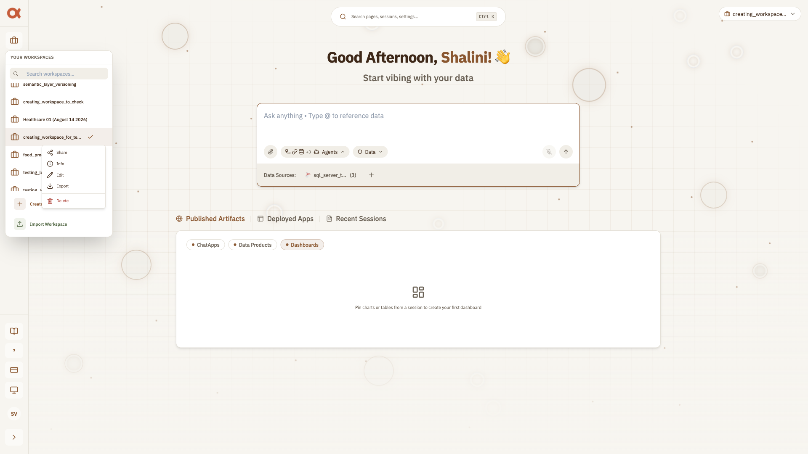
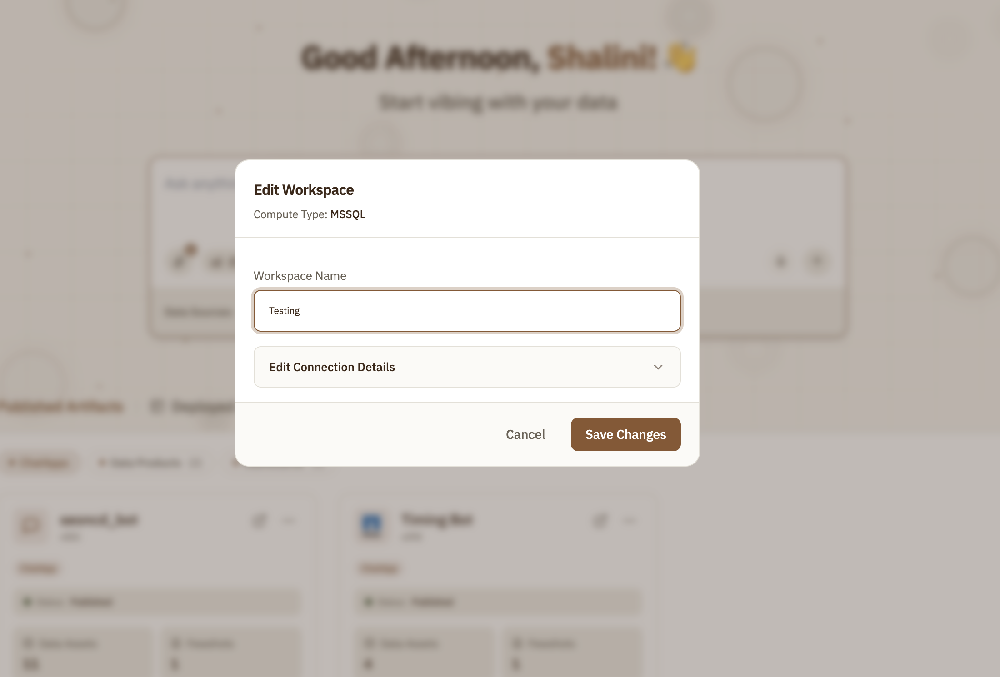
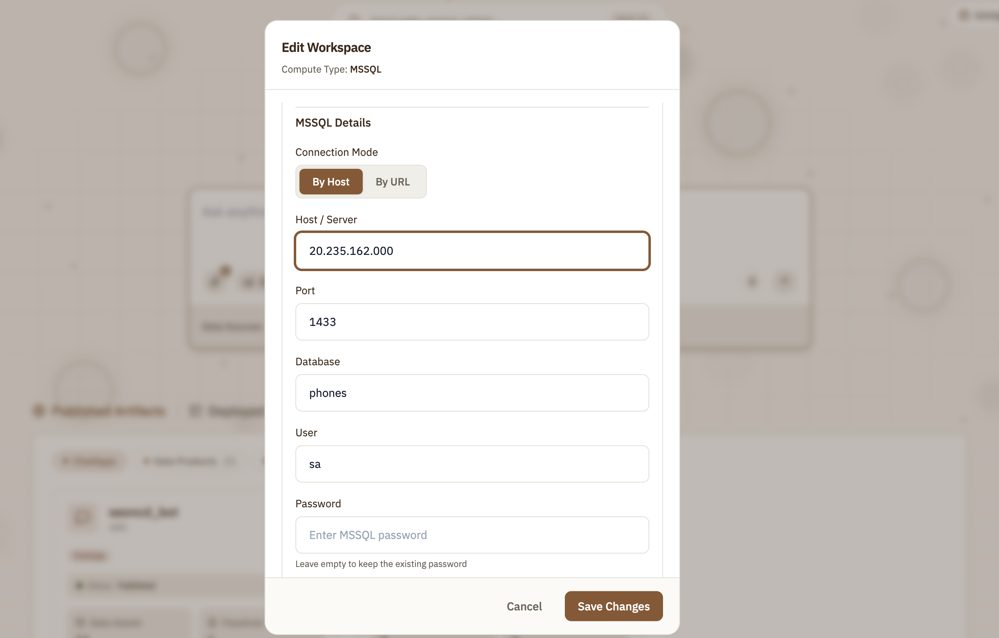

# Editing Workspace Compute Connection Details

This guide explains how to edit the compute connection details for a workspace.

## Steps to Edit Workspace Connection

To edit the compute connection details for an existing workspace:

1. Navigate to the **Workspaces** list.
   
2. Click **Edit**. In the dialog, you can update the workspace name. Select **Edit Connection Details** to expand the compute connection settings.
   
3. Update the necessary compute connection details and save your changes.
   
